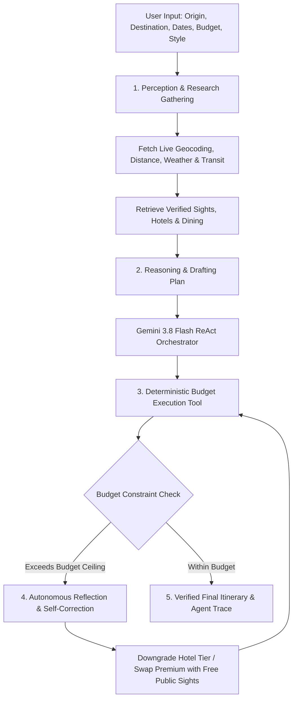

# 🌍 WanderAgent AI — Autonomous Research-Based Travel Planner for India
### *An Agentic AI Mini-Project with Real Data Providers, ReAct Self-Correction & Multi-Tool Orchestration*

[](https://python.org)
[](https://flask.palletsprojects.com/)
[](https://react.dev/)
[](https://ai.google.dev/)
[](https://www.openstreetmap.org/)
[](#)

---

## 📌 Project Overview

**WanderAgent AI** is a full-stack, autonomous travel planning application designed to demonstrate core **Agentic AI** principles for engineering mini-projects. Unlike standard AI chatbots that generate hallucinated or generic itineraries (such as *"visit local attractions"* or *"eat at local eateries"*), WanderAgent AI grounds every decision in **real, destination-specific research data for India**:

- **Real OpenStreetMap & OSRM Geocoding & Routing**: Live road distance, driving durations, and coordinates between Indian cities (e.g., Mumbai to Udaipur = 699.1 km, ~8.6 hrs).
- **Indian Railways & Intercity Transit Fare Engine**: Realistic train fares across Sleeper, 3AC, and 2AC classes with direct **IRCTC** booking links, flight cost estimates with **Google Flights** links, and bus links.
- **Live Weather via Open-Meteo API**: Real-time current temperatures, conditions, and travel weather advisories.
- **Wikipedia REST Grounding**: Verified historical facts, monument descriptions, and official Wikipedia links for Indian attractions.
- **Verified Hotel Comparison Engine**: Accurate price-per-night estimates, amenities, and direct search links on **Google Hotels** and **MakeMyTrip**.
- **Authentic Dining & Sights**: Verified monuments with actual ticket fees, best visiting hours, and renowned local restaurants with Google Maps links.

---

## 🧠 Agentic AI Architecture: ReAct Loop & Self-Correction

The application implements a true **Reason + Act + Reflect (ReAct)** agentic loop:



### Key Agentic Behaviors Demonstrated
1. **Perception & Multi-Tool Invocation**: Autonomous coordination between geocoding, transit, weather, hotel, and destination providers.
2. **Deterministic Arithmetic Tools**: Avoids LLM calculation hallucinations by delegating financial sums, per-person splits, and transit fees to Python tool functions.
3. **Budget Constraint Validation**: Compares computed total against the user's budget ceiling.
4. **Self-Correction (Reflection)**: If over budget, the agent self-reflects, automatically scales accommodation tiers, substitutes expensive tours with highly rated free landmarks, and re-validates before generating output.
5. **Transparent Execution Trace**: The UI displays a live agent trace badge (`Autonomous ReAct Loop`, `Auto-Revised to Fit Budget`) and step-by-step logs.

---

## 🛠️ Technology Stack

| Layer | Technology | Details |
| :--- | :--- | :--- |
| **Frontend** | React 18 + Vite | Modern responsive UI, glassmorphic dark theme |
| **Styling** | Vanilla CSS | Custom design system with zero framework lock-in |
| **Backend** | Python 3.12 + Flask | RESTful API server with CORS support |
| **LLM Engine** | Google Gemini API (`gemini-3.8-flash`) | Structured JSON generation with strict validation |
| **Research Providers** | OSM Nominatim, OSRM, Open-Meteo, Wikipedia REST | Real data without mock templates |
| **Agent Tools** | Pure Python Functions | Budget estimators, transit engine, constraint checkers |

---

## 📂 Project Structure

```text
AgenticAI mini-project/
├── .gitignore                   # Ignores .env, venv/, node_modules/, cache
├── README.md                    # Project documentation & viva guide
├── backend/
│   ├── .env                     # Local environment file (DO NOT COMMIT)
│   ├── .env.example             # Template for API keys
│   ├── app.py                   # Flask REST API endpoints
│   ├── config.py                # Environment configuration loader
│   ├── requirements.txt         # Backend Python dependencies
│   ├── agent/
│   │   ├── __init__.py
│   │   ├── orchestrator.py      # ReAct agent loop, tool calls & reflection
│   │   └── prompts.py           # System prompts & schema constraints
│   ├── providers/               # Real research data providers
│   │   ├── __init__.py
│   │   ├── base_provider.py     # Base HTTP provider with timeouts & headers
│   │   ├── geocoding_provider.py# OpenStreetMap Nominatim geocoding
│   │   ├── routing_provider.py  # OSRM road distance & driving duration
│   │   ├── weather_provider.py  # Open-Meteo live weather & climate alerts
│   │   ├── wikipedia_provider.py# Wikipedia REST API summaries & links
│   │   ├── transit_provider.py  # Indian Railways / flight / bus fare engine
│   │   ├── hotel_provider.py    # Verified hotel engine with booking links
│   │   ├── osm_places_provider.py# Overpass / OSM attractions & restaurants
│   │   ├── india_destinations_kb.py# Verified Indian hub database
│   │   └── provider_manager.py  # Unified research coordinator
│   ├── tools/
│   │   ├── __init__.py
│   │   ├── budget_tools.py      # Expense arithmetic & constraint validator
│   │   └── travel_tools.py      # Provider-connected destination tools
│   └── data/
│       └── travel_benchmarks.json
└── frontend/
    ├── package.json
    ├── vite.config.js
    └── src/
        ├── App.jsx              # Main dashboard
        ├── index.css            # Glassmorphism design tokens
        ├── components/
        │   ├── Navbar.jsx       # Header & health status indicator
        │   ├── TripForm.jsx     # Origin, destination, dates, budget form
        │   ├── AgentTrace.jsx   # Visual ReAct reasoning steps
        │   ├── ItineraryView.jsx# Transit, weather, hotel & day-by-day view
        │   ├── BudgetSummary.jsx# Category breakdown & budget bar
        │   └── ChatAssistant.jsx# Interactive follow-up travel concierge
        └── services/
            └── api.js           # Frontend API client
```

---

## 🚀 Quickstart Guide

### Prerequisites
- **Python 3.10+**
- **Node.js 18+** & npm
- *(Optional but recommended)* A free Gemini API key from [Google AI Studio](https://aistudio.google.com/)

---

### Step 1: Set Up & Run the Flask Backend

```bash
# Navigate to the backend folder
cd backend

# Create a virtual environment (if not already created)
python -m venv venv

# Activate the virtual environment
# On Windows PowerShell:
.\venv\Scripts\Activate.ps1
# On macOS/Linux:
# source venv/bin/activate

# Install dependencies
pip install -r requirements.txt

# Create your .env file from the example
cp .env.example .env
# Edit backend/.env and paste your GEMINI_API_KEY

# Start the Flask API server
python app.py
```
> Backend runs at: `http://127.0.0.1:5000`  
> Health check: `http://127.0.0.1:5000/api/health`

---

### Step 2: Set Up & Run the React Frontend

Open a new terminal:

```bash
# Navigate to the frontend folder
cd frontend

# Install npm dependencies
npm install

# Start Vite dev server
npm run dev
```
> Frontend runs at: `http://localhost:5173`

---

## 📡 REST API Endpoints

| Method | Endpoint | Description |
| :--- | :--- | :--- |
| `GET` | `/api/health` | Health status and active LLM configuration |
| `GET` | `/api/destinations` | Popular Indian destination presets |
| `GET` | `/api/destinations/search?q=...` | Live geocoding search for Indian cities |
| `POST` | `/api/transit-options` | Intercity distance, train, flight, and bus estimates |
| `POST` | `/api/plan-trip` | Executes the ReAct agent loop and returns the complete itinerary |
| `POST` | `/api/chat-assistant` | Follow-up conversational adjustments (budget revision, style changes) |

---

## 🔒 Security Best Practices

- Sensitive API keys are stored in `backend/.env`, which is strictly ignored by `.gitignore`.
- An environment template is provided at `backend/.env.example`.
- Never commit `.env` or the `venv/` directory to public version control.

---

## 📄 License
This project is open-source and available under the [MIT License](LICENSE).
